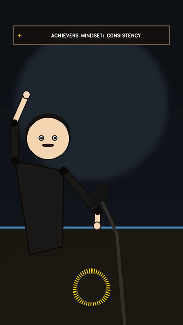
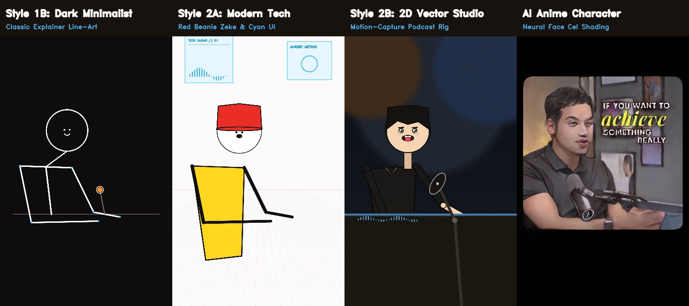
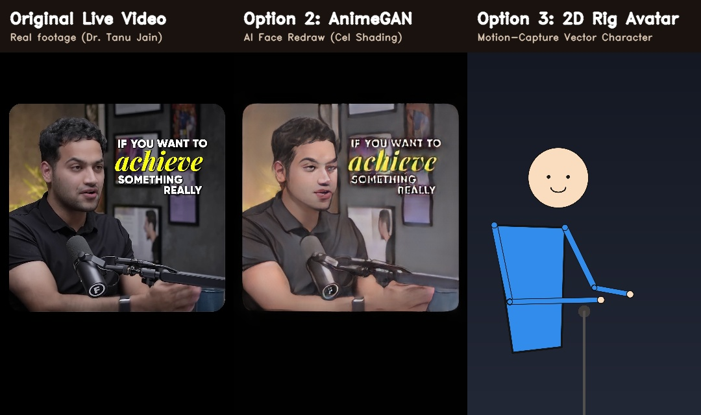

<div align="center">

# 🎬 Video-to-2D Animation Studio
### Turn Real-Life Videos into Viral 2D Animated Shorts & Reels with Lossless Audio

[](https://www.python.org/downloads/)
[](https://streamlit.io)
[](https://opensource.org/licenses/MIT)
[](http://makeapullrequest.com)

**Fast, CPU/GPU-friendly AI video transformer optimized for YouTube Shorts, Instagram Reels, and TikTok.**  
Combines cinematic 2D character rigging from [`kaomei/stickman-video-director`](https://github.com/kaomei/stickman-video-director) with code-driven reactive motion graphics from [`yihui-dev/awesome-opus5-5-videos`](https://github.com/yihui-dev/awesome-opus5-5-videos).

<p align="center">
  
</p>

</div>

---

## 🌟 Key Highlights

- **🎭 True 2D Vector Character Avatars**: Transforms human actors into smooth, modern animated characters instead of blurry pixel filters.
- **🗣️ Audio-Reactive Lip-Sync**: Extracts speech RMS loudness envelopes to modulate mouth shapes naturally in real-time.
- **⚡ MediaPipe Motion Tracking**: 33-landmark skeleton tracking with Exponential Moving Average (EMA) smoothing ($\alpha = 0.35$) for zero-jitter hand and body gestures.
- **✨ Opus 5.5 Motion Graphics**: 
  - Dynamic 48-band circular audio equalizer ring.
  - Ambient upward-drifting bokeh particle field.
  - High-contrast, auto-scaled mobile Glassmorphism kinetic title banner.
- **🔊 100% Lossless Audio Preservation**: Direct stream-copy muxing (`-c:a copy`) ensures zero distortion and zero sync drift.
- **💻 Runs Completely Locally**: No cloud API keys required, lightweight RAM footprint, and fast execution on Windows, Mac, or Linux.

---

## 🎨 Animation Styles Showcase

<p align="center">
  
</p>

| Style | Aesthetic & Setting | Best For |
| :--- | :--- | :--- |
| **Style 2B: 2D Vector Broadcast Studio** | Modern podcast rig, table & broadcast mic, clean color fills | Podcast clips, interviews, talking-head shorts |
| **Style 2A: Modern Studio Tech** | Apple Keynote white floor grid, cyan holographic UI, Red Beanie Zeke | Tech explainers, coding tutorials, startup showcases |
| **Style 1B: Classic Minimalist Dark** | Pure pitch-black canvas with bold, glowing white stick lines | Motivational quotes, philosophical breakdown videos |
| **Style 1A: Classic Minimalist Light** | Crisp high-key white background with smooth black ink strokes | Quick whiteboard explainers, napkin sketches |
| **AI Anime Cel-Shading** | Neural cartoon cel-shading via PyTorch AnimeGANv2 | Cinematic real-world anime transformation |

---

## 📊 Before & After Comparison

<p align="center">
  
</p>

---

## 🚀 Quick Start

### 1. Clone the Repository
```bash
git clone https://github.com/satyasanatan989/video-to-2d-studio.git
cd video-to-2d-studio
```

### 2. Install Dependencies
```bash
pip install -r requirements.txt
```

### 3. Launch the Studio
**On Windows:**
Double-click `run_windows.bat` or run:
```bash
python -m streamlit run app.py
```

**On macOS / Linux:**
```bash
streamlit run app.py
```

Open **`http://localhost:8501`** in your browser.

---

## 🛠️ How It Works

```
                     Input Video & Speech Audio
                                 │
         ┌───────────────────────┴───────────────────────┐
         │                                               │
         ▼                                               ▼
MediaPipe PoseLandmarker (33 keypoints)        Audio RMS Extraction (16 kHz mono)
         │                                               │
         ▼                                               ▼
Temporal Smoothing (EMA α = 0.35)             Loudness Envelope (0.0 – 1.0)
         │                                               │
         └───────────────────────┬───────────────────────┘
                                 │
                                 ▼
                     Vector Rigging & Lip-Sync
            (Style 2B Studio / Style 2A Tech / AnimeGAN)
                                 │
                                 ▼
                    Opus 5.5 Motion Overlays
             (Equalizer Ring + Particles + Title Banner)
                                 │
                                 ▼
                 Lossless FFmpeg Audio Muxing
                 (`-c:v libx264 -c:a copy`)
                                 │
                                 ▼
                Ready-to-Post 1080×1920 Short / Reel
```

---

## 📁 Repository Structure

```
video-to-2d-studio/
├── app.py                      # Main Streamlit web application & render pipeline
├── stickman_styles.py          # Vector character rigs & MediaPipe motion tracker
├── opus_motion.py              # Code-driven motion graphics & prompt library
├── pose_landmarker_lite.task   # MediaPipe pretrained landmark model
├── requirements.txt            # Python package dependencies
├── run_windows.bat             # One-click launcher script for Windows
├── smoke_test.py               # Automated end-to-end test verification
├── demo/                       # Demo showcase assets & sample output video
│   ├── sample_dual_optimized_short.mp4
│   ├── demo_preview.gif
│   ├── styles_showcase.jpg
│   └── comparison_preview.jpg
└── README.md
```

---

## 🤝 Acknowledgments & Credits

- Character direction and visual themes inspired by [`kaomei/stickman-video-director`](https://github.com/kaomei/stickman-video-director).
- Code-driven animation techniques and prompt repository inspired by [`yihui-dev/awesome-opus5-5-videos`](https://github.com/yihui-dev/awesome-opus5-5-videos).
- Pose estimation powered by [Google MediaPipe](https://developers.google.com/mediapipe).
- Anime neural cel-shading powered by [AnimeGANv2](https://github.com/bryandlee/animegan2-pytorch).

---

## 📄 License

This project is licensed under the MIT License - see the [LICENSE](LICENSE) file for details.
